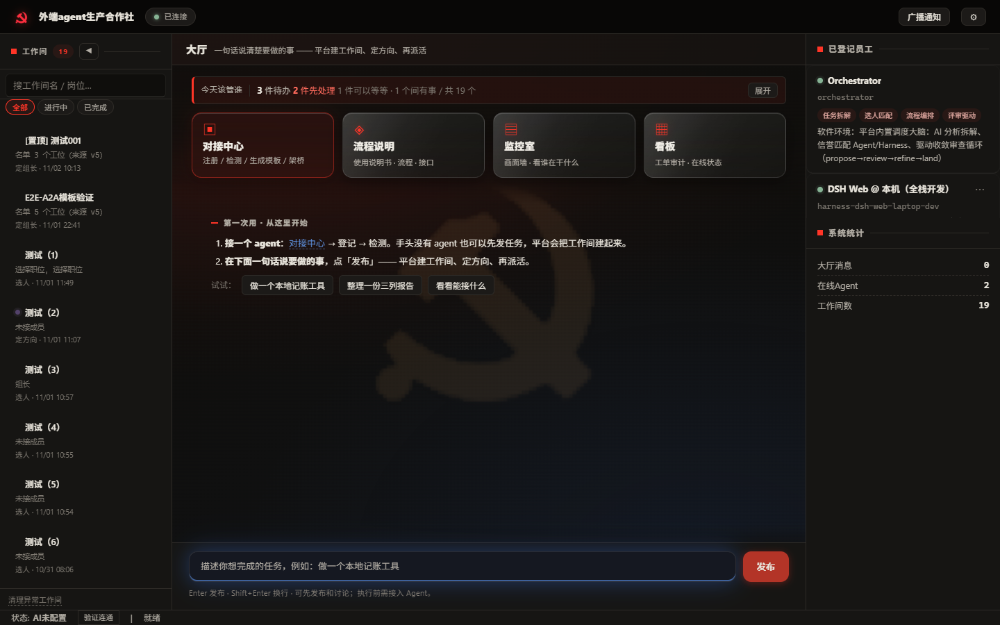
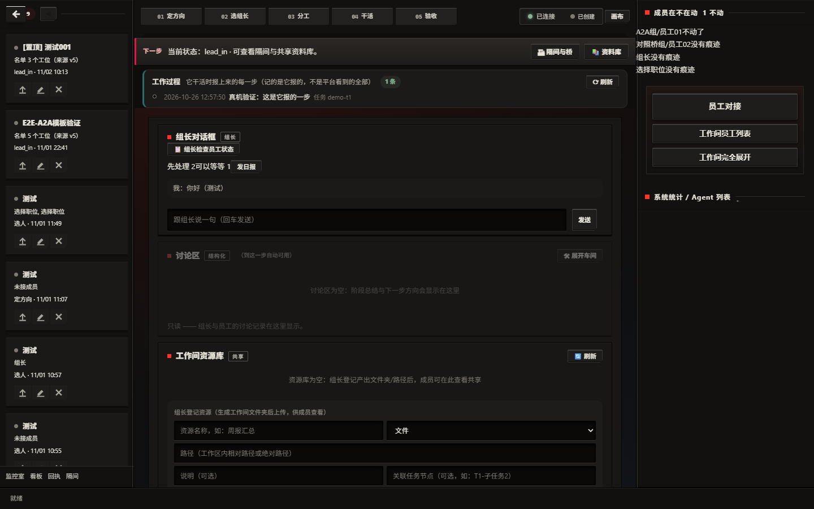

# 外端Agent生产合作社（External Agent Community） v4

> **当前版本：`4.47.0`**（以 `agent_community/__init__.py` 的 `__version__` 为准；每次发版见 [`CHANGELOG.md`](CHANGELOG.md)）

**外端 Agent 生产协作平台** — 让接入不同 harness 的外端 Agent 协同生产，通过命令行即可启动、无需浏览器。

## 先看界面（截图来自真实实例，数据是**演示数据**）





> 两张图都是**当前界面**（大厅的「今天该管谁」摘要条、工作间的「成员在不在动 / 组长待办」）。
> 旧的注册页镜像图（1.25 MB）已删——它早已不是入口，留着只会让人以为平台还是 8 月那副样子。

## 30 秒跑通（复制即用）

```bash
git clone https://github.com/TNDHY-cby/agent-community-v4.git
cd external-agents-community
pip install -r requirements.txt
python -m agent_community.cli start          # 起服务 + 桌面窗口；只要后端就加 --no-gui
python -m agent_community.cli task "写一个排序函数"   # 另一终端：提交第一个任务
```

看到什么：窗口打开 → 大厅显示「工作间/任务/员工」→ 上一条命令建出任务并自动为它开一个工作间。
**下一步是接入一个 agent**（没有 agent 时任务会停在进行中，并如实提示"先接入 Harness"）。

## 三条安装路径（按你的环境挑一条）

| 方式 | 适合 | 命令 / 说明 | 判据 |
|---|---|---|---|
| **源码直跑** | 想读代码、要改 | 上面 30 秒那段（Python **3.10+**） | `python tools/first_run_check.py --src .` |
| **Docker** | 不想碰本机 Python | 仓库根有 `Dockerfile`，`docker build -t ac4 . && docker run -p 18920:18920 ac4` | 容器内 `/api/status` 回 200 |
| **桌面窗口** | 想双击就用 | `启动合作社.vbs`（Windows）/ `python -m agent_community.cli start` | `python tools/launcher_check.py` |

> **端口/数据目录因人而异**：只改环境变量，不改代码 —— `AC_PORT` / `AC_DATA_DIR`。
> **装不上、卡住、端口被占？** 先看 [`docs/FAQ.md`](docs/FAQ.md)（常见故障与"为什么"），
> 仍不行的把它贴到 GitHub 的 Issues（<https://github.com/TNDHY-cby/agent-community-v4/issues>）。

## 它跟"前端编排工具"不是一层东西（定位，先说清）

| | 本仓库 | 典型前端编排工具（如 Ekko / LobeChat 这类） |
|---|---|---|
| 强在哪 | **协议标准 + 可验证的协作**：**5 种协议已通**（HTTP/PIPE/ACP/MCP/**A2A**）＋ gRPC 可选 ＋ WS 部分 ＋ SSE 规划中（逐条状态见下方「协议矩阵」，别信口头数字）；**证据分「谁验的」**（A 档=平台发一次性口令、它答对；B 档=平台自己写测试消息、看桥真取走；C 档=你打的勾，界面必须分开显示）；**名单与实到对不上时说人话**（"还差 2 个（前端组#4、#5）——空工位不能派活"）；验收失败给「卡在哪一步/该谁补/补完点哪」；判据双平台真跑（Windows＋Linux 各 2500+ 条） | **产品化与分发**：安装包、可视化编排画布、IM 渠道、移动端 |
| 缺在哪 | **包装**：没有可视化画布、没有安装包、截图少（正在补） | 协议层通常只有 MCP，**没有 A2A**、没有协作治理、没有评测闭环 |

> **关于信誉的诚实说明**：平台**有**本地信誉记录（按能力维度记成功率与评分，并做低样本惩罚），
> 它只用于**本地调度参考**（选人提示；低于阈值的候选不会被匹配）。
> 它**不参与跨组织证据采信，也不作为本平台的对外承诺**——跨组织只认「接收方独立复核过」的证据（见下条）。

> **关于"可验证"的边界（别被这个词误导）**：我们目前能保证的是
> **产物 `sha256` 可离线重算、凭据必须指向真实位置、模型自报永不采信**；
> **没有**做到密码学级的"可携带证明"（那种做法要求证据来自 agent 写不进去的日志 + 不可控签名者）。
> 所以对外说「**可自持验证**」，不说「已实现可验证消息协议」。

⇒ 我们的位置是**它们缺的后端 runtime 层**：你要"看得见的画布"，我们提供"画布背后的协议与治理"。
两者可以对接（`A2A` + `HTTP` 就是接口），**不打算做成它们的替代品**。


> 同一个 AI 接入不同 harness（编辑器 / 终端 / 桌面 Agent / CLI Agent）后，表现并不相同。
> 平台不假设 Agent 同构，而是按各 harness 的框架能力编排协作：注册发现 → 架桥激活 → 工作间协商 → 委托执行 → 评估沉淀。

> **仓库地址（GitHub，主仓库）**：<https://github.com/TNDHY-cby/agent-community-v4>
> 下载：`git clone https://github.com/TNDHY-cby/agent-community-v4.git`，
> 或打开上面地址点「Code」→「Download ZIP」。
> ℹ️ **主仓库在 GitHub**（2026-11-04 起）；Gitee 那份是**备用镜像**（保留可用，但不再是主发布目标）。
> 每次发布后两边的 `master` 应一致，核对方式是**问远端**（`git ls-remote` 的 sha == 本地 HEAD）。

## 这个仓库里有什么（**想直接看内容，从这里点**）

本仓库是**公开**的：不用克隆，打开上面的 GitHub 地址就能在网页里直接浏览下面这些内容。

| 想看什么 | 去这里 |
|---|---|
| **★ 我要怎么用这个平台（从零到跑通，15 步）** | [`design-docs/使用流程_从零到跑通.md`](design-docs/使用流程_从零到跑通.md) ← **用户先看这份** |
| **项目到底在做什么、边界在哪** | [`design-docs/项目完整模型.md`](design-docs/项目完整模型.md) |
| **完整建模（主模型 26 节 + 12 分册 + 明细册）** | [`V116`](design-docs/V116_v5完整模型_整合版_2026-10-27.md) · [`model/`](design-docs/model/) · [`V118`](design-docs/V118_组织拓扑与团队资产_建模_2026-10-28.md) |
| **全部设计稿（189 份设计稿 + 1 份索引，带状态）** | [`design-docs/索引.md`](design-docs/索引.md) ← 从这里挑 |
| **本地优先 + 中心中转**（当前架构方向） | [`design-docs/V66_本地优先与中心中转架构设计.md`](design-docs/V66_本地优先与中心中转架构设计.md) |
| **派活与回执走中转 / 一个 Hub 服务多家公司** | [`V67`](design-docs/V67_派活与回执走中转_M2设计.md) · [`V68`](design-docs/V68_一个Hub服务多家公司_公司隔离设计.md) |
| **没有公网服务器怎么当中转**（三条路） | [`design-docs/RUNBOOK_没有公网服务器怎么当中转.md`](design-docs/RUNBOOK_没有公网服务器怎么当中转.md) |
| **接入一个 agent 要准备什么 / 桥怎么跑通** | [`CHECKLIST_接入者要准备什么`](design-docs/CHECKLIST_接入者要准备什么.md) · [`RUNBOOK_桥怎么跑通`](design-docs/RUNBOOK_桥怎么跑通.md) |
| **发版怎么发（GitHub 主，SSH over 443；Gitee 备用）** | [`design-docs/RUNBOOK_发布到GitHub_SSH443.md`](design-docs/RUNBOOK_发布到GitHub_SSH443.md) |
| **前端交接件（对外契约 + 可执行预检）** | [`外包交接_前端界面/`](外包交接_前端界面/) |
| **这个平台怎么被验证的（判据清单）** | [`AGENTS.md`](AGENTS.md) 的「产品化硬规则」段 |
| **每个版本改了什么** | [`CHANGELOG.md`](CHANGELOG.md) |
| **许可证** | **双许可**：[`LICENSE`](LICENSE)（**AGPL-3.0**，可自由使用/修改/自部署）· [`COMMERCIAL-LICENSE.md`](COMMERCIAL-LICENSE.md)（闭源嵌入或对外托管服务时购买）。⚠️ 直白说清：AGPL 下**把它当对外服务托管给第三方用**会触发"提供源码"的义务（不只是"分发安装包"才算）；要把本平台嵌进闭源产品、或不打算开源你的改动 ⇒ 走商业许可。 |


## 协议矩阵（多接口多选择）

平台支持多种通信协议，harness 可按自身能力选择最合适的接入方式：

| 协议 | 方向 | 适用场景 | 状态 |
|---|---|---|---|
| **HTTP** | 双向 | 通用默认；注册/心跳/消息回报 | ✅ 已通 |
| **WS** | 出站 | 长连接实时通信 | ⚠️ 部分 |
| **PIPE** | 出站 | 本地进程间通信 | ✅ 已通 |
| **ACP** | 出站 | CLI / 桌面 Agent（拉起子进程 JSON-RPC stdio） | ✅ 已通 |
| **MCP** | 双向 | Claude Code / Cursor 等 MCP 客户端挂载；平台也可调外部 MCP 工具（需另起 mcp_server 进程） | ✅ 已通 |
| **A2A** | 双向 | Agent-to-Agent 标准协作（外部生态 Agent 发现与派发；需另起 a2a_server 进程） | ✅ 已通 |
| **SSE** | 出站 | 单向事件流 | 🔒 规划中 |
| **gRPC** | 出站 | 高性能二进制传输（A2A 第二绑定） | 🔒 可选（需另装 grpcio + 另起网关进程） |

MCP 挂载：`claude --mcp-config '{"servers":{"ac4":{"command":"python","args":["-m","agent_community.mcp_server"]}}}'`
A2A 发现：`GET http://<host>:9104/.well-known/agent-card.json`

## 合作社机制（核心创新）

平台引入「合作社」治理模型——不是简单的任务分配，而是**按能力与经验组织协作**：

- **经验/信誉记录**：每次任务完成会记录质量分与经验，**沉淀为可读的数据**（⚠️ "按信誉排序派活"属**暂停项**，见本节末）
- **能力匹配选人**：按成员声明的能力与角色派活（这是**当前生效**的选人依据）
- **组长由你选，平台只筛资格**：只列**够格**当组长的（能写文件 `fs_write` + 有协议/桥），按名字排序，**不替你推荐、不自动选**
- **决策模式**：用户决定 / 组长独裁 / 举手投票——按场景选择治理方式
- **评估闭环**：工作间完成后自动评估（成员覆盖 + 讨论活跃 + 无阻塞），沉淀为经验供后续复用
- **结构化讨论（AILP 2.0）**：四类消息（提案 / 质疑 / 支持 / 结论），必须引用 manifest 里的条目；
  ⚠️ 旧的「一级讨论 / 三级讨论（自由发言）」**已退役**（`POST …/discuss` 现在返回 `410 FREECHAT_RETIRED`），讨论统一走 `POST …/ailp`

## 快速开始

> 前置：**Python 3.10+**。不需要联网安装本包 —— 这是一个**可直接运行的源码仓库**
> （`pip install agent-community` 暂时没有发包，别照那句做，会 404）。
>
> ⚠️ **Python 版本说明（如实）**：CI 在 **3.11**（Linux + Windows 两个作业）上真跑过安装 +
> 全量测试；**其它版本没有逐一验证**。如果你用的是更新的 Python（3.13/3.14）而某条依赖
> 恰好没有对应版本的预编译轮子，`pip install` 会退化成**源码编译**（很慢、可能失败）——
> 那不是项目坏了，换个 3.11 的解释器即可。遇到"装了十分钟没动静"先看这一条。

```bash
# 1. 装依赖（在仓库根目录执行）
python -m pip install -r requirements.txt

# 2. 起服务（默认端口 18920；加了桌面窗口；首次会自动创建数据目录）
python -m agent_community.cli start

#    · 不想要桌面窗口、只要后端：加 --no-gui
#    · 换端口：--port <你的端口>（**端口因人而异**，下文示例统一用 $PORT 指代）
#    · 起完会自动打开浏览器；也可以自己开 http://127.0.0.1:<port>/

# 3. 发一个任务试试（提交后平台会自动为它建一个工作间）
python -m agent_community.cli task "写一个排序函数"

# 4. 看结果（输出里会打印结果正文；没有结果时会说明为什么）
python -m agent_community.cli task-result <task_id>

# 5. 停服务
python -m agent_community.cli stop
```

> ⚠️ **刚装好、还没接入任何 Harness 时**：任务能提交、工作间能建，
> 但**没有成员参与** ⇒ 结果可能是空的。这时 `task-result` 会直说
> 「没有成员参与 —— 平台还没有接入任何 Harness」并给下一步指向，
> **不是坏了**。要真正跑通协作，先做下面的《Harness 接入指南》。
> 有配 AI Provider 时，平台自己的助手会先给出一版回答（`结果:` 那一段）。

**想跑测试**（可选）：`python -m pytest -q`（依赖里已含 pytest）。

**填过 key 但连不上？先体检一次**（只给位置与指纹，**不打印明文**）：

```bash
python tools/credential_check.py          # exit 0=没发现问题；1=有弱值/明文，按上面逐条改
```

它会扫 `.env` / `config.local.json` / `data/keys/` / 桥脚本，指出"第几行那个 key 太短/是示例占位值"、
"这份桥脚本里明文有你的 key，别外发"。界面上同一个能力是「体检」按钮（`POST /api/credentials/scan`），
`GET /api/status` 的 `credentials` 段会显示摘要。

**装不上桌面窗口？** 桌面窗口用 `pywebview`（Windows 需要 WebView2 运行时）。
装了起不来就加 `--no-gui` —— **后端与 CLI 不依赖它**，功能一样。

## CLI 命令

### 服务管理

```bash
# 启动服务（后台运行；AI 配置在「桌面窗口 → 设置」里做，或见下文「AI Provider 配置」的环境变量）
#   可用参数只有三个：--port / --wakeup / --gui|--no-gui
python -m agent_community.cli start [--port 18920] [--wakeup] [--no-gui]

# 停止服务
python -m agent_community.cli stop

# 查看状态
python -m agent_community.cli status
```

### 任务操作

```bash
# 提交任务
python -m agent_community.cli task "你的任务描述"

# 查询任务结果
python -m agent_community.cli task-result <task_id>
```

### 信息查询

```bash
# 列出已注册 Harness
python -m agent_community.cli harness list

# 列出平台 Agent
python -m agent_community.cli agents list
```

## 环境变量

<!-- ENV_TABLE:BEGIN（由 tools/gen_env_docs.py 生成，勿手改）-->
以下**全部都有默认值** —— 一个都不设也能起（AI 不配时走规则兜底）。
换端口 / 换数据目录 / 换服务商**都只改环境变量，不改代码**；本表由
`agent_community/platform/env_spec.py` 自动生成（`python tools/gen_env_docs.py`）。

| 变量 | 说明 | 默认值 | 必需 |
|---|---|---|---|
| **— 部署核心 —** | | | |
| `AC_ENV` | 运行模式：留空=开发；`production` 时对条件必需项更严格（缺了不让启动） | `（空）` | 否 |
| `AC_PORT` | 平台监听端口（**端口因人而异**，命令行 `--port` 优先级更高） | `18920` | 否 |
| `AC_HOST` | 平台监听地址。默认 0.0.0.0（容器/局域网可达）；只想本机访问填 127.0.0.1 | `0.0.0.0` | 否 |
| `AC_DATA_DIR` | 运行数据目录（工作间/审计/记忆/桥产物都落这里）。**换目录不改代码**就靠它 | `<仓库>/agent_community/data` | 否 |
| `AC_MIND_ROOT` | **心智根（根A）目录**：每个 agent 的永久记忆（宪章/记忆索引/memories/日志/死胡同）都在这。空＝默认 `<AC_DATA_DIR>/minds`。它**必须与工作区（根B）分开**——工作区可整根归档，记忆不能跟着丢 | `（空）` | 否 |
| `AC4_TOKEN` | 平台访问令牌（跨机/对外访问时必设；空=仅本机可用） | `（空）` | 条件必需（对外暴露平台（AC_HOST 非回环）时） |
| `AC_EXTERNAL_READONLY` | 外部访问只读档：=1 时**非本地**请求只放行查看类 GET，写操作一律 403（默认 0） | `0` | 否 |
| `AC4_SHUTDOWN_PIN` | 关停口令（空=关停端点仅允许本机来源 + 二次确认） | `（空）` | 否 |
| `AC_LAUNCHER_BROWSER` | 启动器用哪个浏览器打开过场页/大厅（如 `firefox`；空=系统默认浏览器）。写可执行文件名或绝对路径，**不绑定任何一家浏览器** | `（空）` | 否 |
| `AC_LAUNCHER_PYTHON` | 启动器强制使用的解释器（排障用；空=自动挑一个装好依赖的解释器）。与部署层的 `AC4_PYTHON` 分开：那个是部署配置，这个是启动器临时指定 | `（空）` | 否 |
| `AC_AUTOSTART_DIR` | 开机自启的**入口脚本**放哪（默认 `<仓库>/deploy/autostart`）。⚠️ 别放运行数据目录里：换了 `AC_DATA_DIR` 或数据被清，登录自启的入口就凭空消失（登录时什么都不会起）。测试与多实例场景可以指到临时目录 | `（空）` | 否 |
| `AC_AI_PROVIDER` | AI 后端：`openai`（OpenAI 兼容）/`ollama`/`http_callback`；空=不接 AI | `（空）` | 否 |
| `AC_AI_BASE_URL` | OpenAI 兼容基址（**按你的服务商填**，别照抄示例） | `（空）` | 条件必需（AC_AI_PROVIDER=openai 时） |
| `AC_AI_API_KEY` | AI 服务密钥（**绝不入库**；本地配置里保存时：**Windows 走 DPAPI 加密**（绑定当前用户），其它系统**明文**保存并**打告警**提示改用本环境变量） | `（空）` | 条件必需（AC_AI_PROVIDER=openai（或需要鉴权的服务）时） |
| `AC_AI_MODEL` | 模型名 | `（空）` | 否 |
| `AC_PYTHON` | 平台用哪个 Python 解释器去跑脚本/桥（默认当前解释器） | `（空）` | 否 |
| `AC_ACP_COMMAND` | ACP 拉起命令（桥用它拉起 agent） | `（空）` | 条件必需（手工跑 ACP 类桥且平台未注入时） |
| `AC_AGENT_TOKEN` | Agent-Token（桥回报鉴权；平台注册时签发，通常由平台注入） | `（空）` | 条件必需（平台为该 harness 启用了 Agent-Token 时） |
| **— 功能开关 —** | | | |
| `AC_LAUNCHER_NO_WATCHDOG` | 双击启动器时**不要**顺带拉起看门狗（默认 0＝顺带拉起：崩了能自动拉回）。排障或只想手动起一次时设 1 | `0` | 否 |
| `AC_ARTIFACT_WATCH_SEC` | 收件目录监视间隔（秒，默认 20）：成员把产物文件放进收件目录（档案 `artifact_inbox_dir` 或默认 `<工位>/产物/`），平台每这么久扫一轮，发现新增/内容变化就发事件并写进组长的 `_lead/_notice.md`。**0＝关掉后台扫描**（仍可手动 `POST …/scan-inbox`） | `20` | 否 |
| `AC_NUDGE_ISSUED_MIN` | 催办阈值（分钟，默认 30）：任务派出去了（`issued`/`working`）超过这么久还没有回执/产物，`GET …/nudge` 会把它列出来，`POST …/nudge` 会给接活的人写一条催办通知。**只算不写**的是 GET；真写的是 POST（同一条任务同一天只催一次） | `30` | 否 |
| `AC_ESCALATION` | 分层协商的危急度上报（`/api/escalation*`）开关。默认 1；设 0 时端点 404 | `1` | 否 |
| `AC_ASSET_HEALTH` | 团队资产体检（`/api/asset-health/*`）开关。默认 1；设 0 时只回 enabled=false | `1` | 否 |
| `AC_SQUAD_HISTORY` | 分队履历（`GET …/squads/{id}/record`）开关。默认 1；设 0 时履历为空并说明（不是没有数据，是开关关了） | `1` | 否 |
| `AC_SQUAD_TEMPLATE` | 分队模板化（`POST …/squads/{id}/clone`）开关。默认 1；设 0 时端点 404 | `1` | 否 |
| `AC_ORG_CHART` | 组织关系指针化（`GET …/org-chart` + roster 的 `reports_to`/`level`）开关。默认 1；设 0 时端点 404、roster 不带新字段（**一处开关回滚**，见 V139） | `1` | 否 |
| `AC_REDISPATCH_MAX` | 同一条任务**最多能被重派几次**（默认 3）。到顶以后 `redispatch` 返回 `REDISPATCH_BUDGET_EXHAUSTED` 并把任务标成烂尾（进组长待办），不再无限重试 —— 没有上限时失败只会表现为"一直 pending"，日报里看不出异常 | `3` | 否 |
| `AC_DIGEST_WATCH_SEC` | 后台组长日报的检查间隔（秒，**默认 0＝关**）：>0 时平台每这么久看一遍所有工作间，有要管的事就**自动发一份日报**进组长的 `_lead/_notice.md`（同一天只发一次，没活不发）。**默认关**：主动给人写通知属于自动兜底，不该开箱就动别人的目录 | `0` | 否 |
| `AC_PRESENCE_SILENT_MIN` | 成员失联阈值（分钟，默认 120）：成员**有在途任务**（issued/working）且这么久没有任何痕迹（任务账本更新 / 产物事件）⇒ `GET …/presence` 把他标成 silent 并写清理由。空闲成员不算失联（不制造噪音）；不看窗口画面。 | `120` | 否 |
| `AC_NUDGE_WATCH_SEC` | 后台催办的间隔（秒，**默认 0＝关**）：>0 时平台每这么久自动跑一轮催办（`issued` 超阈值催成员回执 / `delivered` 超阈值催组长验收），同一任务同一天只催一次。**默认关**是因为「平台主动给人写通知」属于自动兜底，不该开箱就动别人的目录 | `0` | 否 |
| `AC_NUDGE_DELIVERED_MIN` | 催办阈值（分钟，默认 60）：产物已到（`delivered`）但组长超过这么久没验收，`POST …/nudge` 会给组长写一条«等你验收»。 | `60` | 否 |
| `AC_STATE_BACKUP_MINUTES` | 状态快照（`data/backups/`）多久拍一份，默认 30 分钟；**0＝关掉自动快照**。快照是 `data/*.json` 的字节复制，恢复用 `tools/state_restore.py` | `30` | 否 |
| `AC_STATE_BACKUP_KEEP` | 状态快照保留最近多少份（默认 20；超出的删最旧的） | `20` | 否 |
| `AC_AI_REASONING_EFFORT` | 思考强度：off/low/medium/high/max（默认 off 省钱） | `off` | 否 |
| `AC_AI_CACHE_ENABLED` | 相同输入复用历史回复（L2 缓存，零 token） | `1` | 否 |
| `AC_AI_CACHE_TTL` | 缓存有效期（秒） | `1800` | 否 |
| `AC_AI_CACHE_MAX` | 缓存容量上限（LRU） | `512` | 否 |
| `AC_AI_CACHE_DIR` | 缓存落盘目录（默认随 AC_DATA_DIR） | `（空）` | 否 |
| `AC_AI_USAGE_ENABLED` | 用量/预算统计开关 | `1` | 否 |
| `AC_SMTP_PORT` | SMTP 端口 | `587` | 否 |
| `AC_SMTP_FROM` | 发件地址 | `（空）` | 否 |
| `AC_SMTP_TO` | 收件地址（可逗号分隔） | `（空）` | 否 |
| `AC_SMTP_TLS` | SMTP 是否 STARTTLS（默认 1） | `1` | 否 |
| `AC_AGENT_INSTALL_ALLOW` | 允许平台执行安装命令（默认关；开了也只执行清单里的命令） | `0` | 否 |
| `AC_AGENT_INSTALL_TIMEOUT` | 安装命令超时秒数 | `600` | 否 |
| `AC_AGENT_CATALOG_EXTRA` | 自定义 agent 清单 JSON 路径（换机器不用改代码） | `（空）` | 否 |
| `AC_WORKFLOW_BATCH` | 工作流一次最多并行推进几个节点 | `3` | 否 |
| `AC_SINGLETON_UNAVAILABLE` | 同一数据目录已有实例时的行为：fail_closed（拒起，默认）或 degraded（起但标记降级） | `fail_closed` | 否 |
| `AC_PROBE_STALENESS_HOURS` | 回话探针结果多少小时算过期（超时后 capability 显示 stale） | `24` | 否 |
| `AC_SNAPSHOT_MAX` | 每个任务保留多少条运行快照（超了丢最旧并留一条截断记录） | `200` | 否 |
| `AC_MCP_TOOLSETS` | MCP 挂载哪些工具组（逗号分隔：api/task/bridge/browser/devices/plan；all=全量） | `api,task` | 否 |
| `AC_MCP_RESOURCE_MAX_BYTES` | MCP 只读资源单次返回的字节上限（超了先翻页、再截断并标注）；最小 1024 | `65536` | 否 |
| `AC_UPDATE_SOURCES` | 更新源列表（逗号分隔，`名字=地址` 或只写地址）；不配则用本仓库 git 远端 | `（空）` | 否 |
| `AC_REPLY_PROBE_ENABLED` | 回话探针总开关（默认关；设 1 才允许发探针，避免无意义开销） | `0` | 否 |
| `AC_REPLY_PROBE_TIMEOUT` | 回话探针等回执的超时秒数 | `120` | 否 |
| `AC_MONITOR_MAX_WATCH` | 监控室同时看几路画面（默认 6；越多越吃 CPU） | `6` | 否 |
| `AC_MONITOR_FPS` | 监控画面刷新帧率上限（默认 1；快照墙够用，调高更吃 CPU） | `1` | 否 |
| `AC_DELIVERY_NOTIFY` | 派活时**顺手**把这句话用统一投递层送到对方界面（默认关：往别人界面打字有副作用）；开了也不影响派发结果 | `0` | 否 |
| `AC_CDP_PORT` | 浏览器级投递（不用真鼠标）要连的 Chromium 调试端口，可逗号分隔多个：目标应用需自己带 --remote-debugging-port 启动（Electron/Trae 这类） | `9222,9223,9224,9225` | 否 |
| `AC_MONITOR_STREAM_MAX_SECONDS` | 单条连续画面流的**硬上限**（秒，默认 600）：到点主动收尾，浏览器会自动重连，免得僵尸连接占线程 | `600` | 否 |
| `AC_MONITOR_AI_OBSERVE` | 监控的「agent 简单观察」总开关（默认关；开了才允许把变化统计交给 AI 说一句话） | `0` | 否 |
| `AC_MONITOR_AI_INTERVAL_MIN` | AI 观察的最小间隔（分钟，默认 30）——**绝不是每帧一次** | `30` | 否 |
| `AC_AI_USAGE_DIR` | 用量落盘目录（默认随 AC_DATA_DIR） | `（空）` | 否 |
| `AC_BUDGET_DAILY` | 日预算（元）；超限熔断 AI 调用 | `2.0` | 否 |
| `AC_BUDGET_MONTHLY` | 月预算（元） | `20.0` | 否 |
| `AC_AI_PRICE_PER_1K` | 单价（元/1K tokens）；0=只计数不估费 | `0.0` | 否 |
| `AC_HTTP_CALLBACK_URL` | http_callback 模式的回调地址 | `（空）` | 条件必需（AC_AI_PROVIDER=http_callback 时） |
| `AC_OLLAMA_HOST` | Ollama 地址 | `http://127.0.0.1:11434` | 否 |
| `AC_OLLAMA_MODEL` | Ollama 模型名 | `（空）` | 否 |
| `AC_LOCAL_AI_AUTOSTART` | 本地模型自动拉起（1/0） | `1` | 否 |
| `AC_LOCAL_AI_QUICK_WAIT` | 本地模型快等多长（秒） | `12` | 否 |
| `AC_LOCAL_AI_BOOT_WAIT` | 本地模型冷启等待（秒） | `90` | 否 |
| `AC_OFFLINE_AUTO` | 掉线自动扫描抢救（**默认关**） | `0` | 否 |
| `AC_CDP_MIRROR_ENABLED` | CDP 镜像（调试用） | `0` | 否 |
| `AC4_BASE_URL` | 本平台对外基址（A2A/gRPC/MCP 回连平台用） | `http://127.0.0.1:<AC_PORT>` | 否 |
| `AC4_A2A_PORT` | A2A 服务端口 | `9104` | 否 |
| `AC4_GRPC_PORT` | gRPC 网关端口 | `9105` | 否 |
| `AC4_A2A_RELAY` | A2A 接力插件开关（默认关） | `0` | 否 |
| `AC4_RELAY_INBOX` | 接力信箱目录 | `（空）` | 否 |
| `AC4_PEER_URL` | 对端平台地址（公司间协作用） | `（空）` | 条件必需（要用 A2A 客户端连对端时） |
| `AC4_COMPANY_ID` | 本/对端公司标识 | `（空）` | 条件必需（设了 AC4_PEER_URL 时） |
| `AC4_COMPANY_TOKEN` | 公司级令牌 | `（空）` | 条件必需（设了 AC4_PEER_URL 时） |
| `AC_FRP_SERVER_ADDR` | frps 地址（公司 B 要被公司 A 访问时才需要） | `（空）` | 条件必需（要生成 frpc 配置把本实例映射到公网时） |
| `AC_FRP_SERVER_PORT` | frps 控制端口 | `7000` | 否 |
| `AC_FRP_TOKEN` | frps 的 token（**绝不入库**，与服务器侧同一串） | `（空）` | 条件必需（要生成 frpc 配置时） |
| `AC_FRP_REMOTE_PORT` | frps 上对外开放的端口（公司 A 就访问它） | `（空）` | 条件必需（要生成 frpc 配置时） |
| `AC_FRP_PROXY_NAME` | frpc 代理名（同一 frps 上区分多个实例） | `ac-company-b` | 否 |
| `AC_PEER_POLL_ENABLED` | 对外任务回执自动收回开关（**默认关**；=1 才开） | `0` | 否 |
| `AC_PEER_POLL_INTERVAL` | 自动收回间隔（秒，最小 10） | `60` | 否 |
| `AC_PEER_POLL_MAX` | 每轮最多查几条回执（1~20） | `3` | 否 |
| `AC_HUB_URL` | 中转服务器地址（**终端只出站连它**；空=不启用中转，本机功能照常） | `（空）` | 条件必需（要跨终端/跨公司协作时） |
| `AC_HUB_TERMINAL_ID` | 本终端在中转里的名字（自己起，如 home-desktop；**空=不启用中转**） | `（空）` | 条件必需（设了 AC_HUB_URL 时） |
| `AC_HUB_TERMINAL_NAME` | 本终端显示名（可选，默认同 ID） | `（空）` | 否 |
| `AC_HUB_TOKEN` | 中转共享密钥（**终端与 Hub 用同一个；绝不入库**） | `（空）` | 否 |
| `AC_HUB_COMPANY` | 本终端所属公司（V68；空=default）。只在**共享中转**下参与隔离判断 | `（空）` | 否 |
| `AC_HUB_SHARED` | 中转形态：=1 共享（按公司隔离）／默认私有（所有终端互通） | `0` | 否 |
| `AC_HUB_ALLOW_CROSS` | 共享中转下是否允许跨公司（=1 允许；每条消息还要显式带 allow_cross） | `0` | 否 |
| `AC_HUB_INBOX_MAX` | 本机收件箱最多保留几条（默认 200） | `200` | 否 |
| `AC_HUB_PORT` | Hub 监听端口（跑中转的那台机器用） | `9400` | 否 |
| `AC_HUB_HOST` | Hub 监听地址（跑中转的那台机器用） | `0.0.0.0` | 否 |
| `AC_HUB_QUEUE_MAX` | Hub 每个终端队列上限（超了按最旧丢） | `200` | 否 |
| `AC_ACP_CWD` | ACP 命令的工作目录 | `（空）` | 否 |
| `AC_ACP_REPO` | ACP 仓库根（部分 harness 需要） | `（空）` | 否 |
| **— 开发/测试内部 —** | | | |
| `AC_ALLOW_LEGACY_DISCUSS` | **兼容口子（默认 0）**：v4 的自由发言讨论区已被结构化讨论（AILP 2.0）取代。只有设 1 才允许 `POST /api/workshop/{id}/discuss` 走旧逻辑（响应里会标 `legacy: true`）；新前端/新客户一律用 `POST /api/workshop/{id}/ailp`（四类结构化消息） | `0` | 否 |
| `AC_ALLOW_LEGACY_AI_SELECT` | **兼容口子（默认 0）**：`POST /api/workshop/{id}/select-members`（让平台 AI 选人）已于 2026-10-31 退役 —— 平台不选人（`V116` §16），名单由组长回执交回（§8.1）。置 1 可临时恢复旧行为（响应会标 `legacy`）。 | `0` | 否 |
| `AC_ALLOW_MANUAL_SIM` | **默认 0（关）**：平台**内部 AI 代成员发言**的应急能力。历史上用于「平台 AI 额度挂掉时由外部 AI 接管」：成员被派发后 90 秒无回报、或派发本身失败时，平台会用内部模型冒充该成员在讨论区发言（消息标 `source=manual-sim`）。**这与 `V116` §16「不做：代成员说话」冲突，所以默认关**；只有在 `ai_mode=manual/off` **且**显式置 1 时才会发生。要它请明确知道自己在花谁的钱。 | `0` | 否 |
| `AC_STATE_ALLOW_EMPTY` | **故意清库**的专用口子（默认 0）：只有设 1 才允许「没加载过状态的进程」用空内存覆盖已有数据。正常运行时**不要**开——它是 2026-10-23 数据被清事故的防线 | `0` | 否 |
| `AC_VERIFY_NO_START_BRIDGE` | 接入自检时**不**自动起桥（测试/排障用） | `（空）` | 否 |
| `AC_FAKE_REPLY` | 假回复（离线跑测试用；**生产别设**） | `（空）` | 否 |
| `AC_REGRESSION_BASE` | 安全回归指向的地址（测试用） | `（空）` | 否 |
| `AC_ACTION` | 动作脚本上下文标记（平台注入） | `（空）` | 否 |
| `AC_HARNESS_ID` | 动作脚本上下文：harness 标识（平台注入） | `（空）` | 否 |
| `TEMP` | 临时目录（系统自带；Windows 下平台会读它） | `（空）` | 否 |
| `USERNAME` | 当前用户名（系统自带；仅在探测/显示里用到） | `（空）` | 否 |
| `DEEPSEEK_API_KEY` | **兼容用**：旧版示例桥读它；新配置请用 AC_AI_API_KEY | `（空）` | 否 |

**用法**：`cp .env.example .env` 后按需修改（`.env` 已在 `.gitignore` 里，不会进仓库）。
**校验**：`python -c "from agent_community.platform import env_spec as e; print(e.check_requirements())"`
—— 缺条件必需项时它会说清「缺哪个、为什么、怎么修」；`AC_ENV=production` 下直接**启动失败**。
<!-- ENV_TABLE:END -->

## AI Provider 配置

**`cli start` 不接受 `--ai-*` 参数**（早期版本有，已取消）。两条路，任选其一：

1. **桌面窗口**：打开平台后进「设置」，填接口地址 / 模型 / 密钥，保存即可（密钥在本机加密保存）；
2. **环境变量**（适合服务器 / 无桌面环境）：

| 环境变量 | 说明 |
|------|------|
| `AC_AI_PROVIDER` | 后端类型：`openai` / `ollama` / `http_callback` |
| `AC_AI_MODEL` | 模型名，如 `deepseek-chat`、`qwen2.5:7b` |
| `AC_AI_API_KEY` | API Key |
| `AC_AI_BASE_URL` | API Base URL（OpenAI 兼容系必填） |

**示例（环境变量方式）：**

```bash
# Linux / macOS
export AC_AI_PROVIDER=openai
export AC_AI_MODEL=deepseek-chat
export AC_AI_API_KEY=sk-xxx
export AC_AI_BASE_URL=https://api.example.com/v1
python -m agent_community.cli start --wakeup
```

```powershell
# Windows PowerShell
$env:AC_AI_PROVIDER="openai"
$env:AC_AI_MODEL="deepseek-chat"
$env:AC_AI_API_KEY="sk-xxx"
$env:AC_AI_BASE_URL="https://api.example.com/v1"
python -m agent_community.cli start --wakeup
```

> 配完可以只验一次：
> `python -m agent_community.cli ai-check`（真跑一次极小探针；失败会给出「原因 + 怎么办」）。

## Harness 接入指南

Harness 是外部 IDE / 工具接入平台的标准化接口。通过 Harness，各类外部 AI 工具可以作为 Agent 参与协作。

> 📖 **完整协议见 [design-docs/Harness通用接入协议.md](design-docs/Harness通用接入协议.md)**（注册/唤醒/派发/回报标准）。
> 核心：任何 harness 处理完任务后，**HTTP POST `/api/harness/task-result`**（带 workshop_id + member_id + result）即可回报，平台自动接入讨论区——不依赖 harness 内部实现。

> **注意**：下面的示例全部使用**虚拟示例名**（如 `示例Harness-A`），请勿照抄——真实 harness 请用你自己的名字注册。

### 注册 Harness

```bash
curl -X POST http://127.0.0.1:$PORT/api/harness/register \
  -H "Content-Type: application/json" \
  -d '{
    "harness_id": "示例Harness-A",
    "harness_name": "示例Harness-A",
    "harness_type": "cli-agent",
    "wakeup_method": "file_poll",
    "wakeup_dir": "<你的收件目录>/inbox",
    "ai": {
      "model_name": "your-model",
      "provider": "your-provider",
      "capabilities": ["coding", "file_ops"]
    },
    "tools": [
      {"name": "edit_file", "description": "编辑文件"},
      {"name": "run_code", "description": "运行代码"}
    ]
  }'
```

> **`wakeup_dir` 填本机真实可写的绝对路径**（把占位符换成你自己的目录）：
> Linux / macOS 形如 `<家目录>/inbox`；Windows 形如 `<盘符>:\\<目录>\\inbox`
> （JSON 里反斜杠要写成 `\\\\`）。平台**不预设**盘符、用户名或目录名。

### 示例 Harness

参考 `agent_community/examples/` 目录下的示例（均为虚拟示例，需改成你自己的 harness_id）：

- `acp_harness_bridge.py` / `filepoll_harness_bridge.py` / `pending_poll_bridge.py` — 三种桥型示例（ACP 子进程 / 文件轮询 / 待取件轮询）
- `waker_with_deepseek.py` — DeepSeek 驱动的 Wakeup Agent

## Harness 架桥指南（注册 ≠ 接入，必须架桥）

**注册只是让 harness 出现在名单里；要真正接到任务，harness 侧必须跑一个「桥」进程。** 平台按 `wakeup_method` 分流任务：

- `file_poll` 类：平台直接把任务 JSON 写进 harness 的 `wakeup_dir`（inbox）→ 用**文件桥**轮询
- `acp` / `http` / `clipboard` 类：平台把激活/任务放进 pending 队列 → 用**通用 pending 桥**轮询领取

三种桥（都在 `agent_community/examples/`）：

| 桥 | 适用 harness | 命令（示例 harness 用占位符，请换成自己的） |
|---|---|---|
| `filepoll_harness_bridge.py` | file_poll（走文件邮箱的桌面 Agent） | `python agent_community/examples/filepoll_harness_bridge.py --harness-id [你的harness_id] --inbox [wakeup_dir] --platform http://127.0.0.1:$PORT` |
| `pending_poll_bridge.py` | acp/http/clipboard（无真实 ACP server，如 GUI 程序） | `python agent_community/examples/pending_poll_bridge.py --harness-id [你的harness_id] --url http://127.0.0.1:$PORT --work-dir [任务目录]` |
| `acp_harness_bridge.py` | acp 且有真实 ACP server | `python agent_community/examples/acp_harness_bridge.py --url http://127.0.0.1:$PORT` |

回报协议（harness 有联网能力时可直接 POST，无需桥）：

```bash
# 激活回报 —— 平台**至少要有一个成员到 active** 才允许开工；没接上的工位不能派活，但不会把整间活儿停住
curl -X POST http://127.0.0.1:$PORT/api/harness/activation-result \
  -H "Content-Type: application/json" \
  -d '{"workshop_id":"ws_xxx","member_id":"m_xxx","status":"entered"}'

# 任务回报
curl -X POST http://127.0.0.1:$PORT/api/harness/task-result \
  -H "Content-Type: application/json" \
  -d '{"workshop_id":"ws_xxx","member_id":"m_xxx","ok":true,"result":"完成了..."}'
```

**激活回报的可选三字段**（V-15 新增，向后兼容，不发也行、发了更准确）：

| 字段 | 作用 |
|---|---|
| `session_id` | 本次会话 id。**缺了平台无法跨重启记住会话**（重启即失忆） |
| `context_turns` | 会话已有上下文轮数，新会话应为 1；`>1` 平台记一条「上下文复用」审计但**不阻断** |
| `source` | `acp` / `mcp` / `plugin` = 机器报，`human` = 人工点击进入。平台据此**区分人报与机器报**，避免冒充 |

无 `session_id` 时平台会合成 `human:{workshop}:{member}:{ts}` 并标 `source=human`。
`status=blocked` 时另可带 `reason`，会直接显示给用户。

桥的统一职责：注册 + 心跳保活 + 轮询领取激活/任务 + 回报结果。详细协议见各桥文件头部注释。

### 桥测试与桥坐标登记

建好桥后，平台会与对象交互验证桥功能，通过后登记桥文件路径（持久化到 harness 记录）：

1. **平台发起测试**：`POST /api/harness/bridge-test` body `{"harness_id":"..."}`
   - file_poll 类：写 `bridge_test` JSON 到 harness 的 inbox；其余：进 `pending-bridge-tests` 队列
2. **桥自动回报**（两个示例桥已内置自动应答）：`POST /api/harness/bridge-test-result` body `{"harness_id","test_id","ok":true,"echo":"..."}`
3. **对象告知桥路径**（测试通过后）：`POST /api/harness/bridge-path` body `{"harness_id":"...","bridge_dir":"桥文件所在文件夹"}` → 平台记录到该 harness 名下，`harnesses.json` 持久化，注册页列表显示 `桥:✅测试通过` + 文件夹路径

### 接入常见问题（避坑清单，来自实测反馈）

1. **技术信息由 harness 本体/AI 探测，不向用户问技术细节**：用户是平台拥有者，不必懂 harness_type / model / capabilities / wakeup_method——接入 AI 应直接读 harness 自身信息（若它就是 harness 本体则用自身真实信息），或探测其配置/启动脚本推断；只能问用户"harness 叫什么、装在哪"这类只有用户知道的事。禁止用 `[如：xxx]` 占位符注册。
2. **中文乱码 → 先看数据再改发送**：服务端响应已带 `charset=utf-8`；PowerShell 显示乱码通常是显示层问题，数据本身是对的，用 Python `decode('utf-8')` 拉取验证。发送侧务必用 UTF-8 字节（Python `json.dumps(...,ensure_ascii=False).encode('utf-8')`，或 PowerShell `[Text.Encoding]::UTF8.GetBytes()`）。
3. **探测平台在线**：注册前先 `GET /api/status` 确认可达；两个示例桥启动时会自动自检（平台在线 + 目录可写），看到 `[自检]` 全 ✓ 再继续。
4. **桥必须常驻**：桥是独立进程，会话/终端结束即停。要随时接活，把桥命令加入开机启动/计划任务。
5. **桥需要目录写权限**：file_poll 桥要写 `wakeup_dir/delivered/`，pending 桥要写 `work-dir/inbox/`。目录在会话工作区外时可能被沙箱拦（WinError 5）——确保桥进程有权限，或放在无沙箱限制的环境跑。
6. **注册覆盖会更新**：同名重注册会覆盖旧配置（注册时间会刷新），桥坐标/测试状态保留最新值。

## 安全说明（重要，2026-09 加固）

平台默认面向**单机本地使用**，涉及外部接口与数据落盘的安全边界如下：

1. **网络访问控制**：未配置 `--token` 时，服务仅允许本地访问（127.0.0.1）；绑定到非本地地址（如 `0.0.0.0`）且未配置 Token 时，非本地请求一律返回 403。配置 Token 后，外部请求须携带 `Authorization: Bearer <token>` 或 `X-API-Key` / `token` 参数。
2. **⚠️ 不要把管理端口反代出去（这条别忽略）**：「是不是本机来源」只看**TCP 对端地址**。
   一旦在前面挂了 nginx / Caddy / 各类隧道（哪怕只是临时排障），对端都会变成 `127.0.0.1`
   ⇒ **Token 校验与只读档会同时失效**，改配置、重启、看日志这些管理面会对外可达。
   平台**不解析** `X-Forwarded-For` / `Forwarded`（没有 `AC_TRUST_PROXY` 这类开关），
   发现这类代理头时只会在日志里**告警一次**，不会替你改判定。
   ⇒ 跨机访问请用**中转**（`V66`：每端只出站），别把 18920 暴露给代理。
3. **数据落盘与权限**：运行数据（`data/` 目录下的 tasks/rooms/harnesses 等 JSON，含对话内容、注册信息、回调地址）以明文持久化，**不会进入开源副本**。服务首次写盘时自动将 `data/` 目录 ACL 收紧为仅当前用户 + SYSTEM（Windows）。如自行部署到多用户环境，请额外确保 `data/`、`config.json` 仅属主可读写。
4. **密钥与凭据**：涉及 API Key 的配置建议使用环境变量（如 `AC_AI_API_KEY`）注入，避免写入配置文件的明文 `key` 字段；落盘含 `key` 时会打印提示。任何情况下不要将真实凭据提交到公开仓库。
5. **外部 Harness 内容隔离**：所有来自 harness 的回报/消息（task-result、message、举手回复）均视为**不可信外部数据**，平台会剥离角色伪装与注入指令行、附加不可信边界标记后再进入讨论上下文，请勿将 harness 输出当作系统指令。
6. **回调与归属校验**：平台对出站 HTTP 地址（注册、api-base-url、唤醒地址）统一做 SSRF 校验（拒绝私网/元数据地址）；对桥测试回报、唤醒举手回报均校验 `test_id` / 唤醒名单归属，伪造回报会被拒绝。
7. **上限保护**：pending 队列、任务数、工作间数均设上限，防止异常灌满内存（P0 DoS 防护）。
8. **⚠️ 屏幕与输入这两组能力的边界（2026-10-25 补，外部审查 P3 指出）**：
   平台带的**监控室（截屏/录像）**与**输入模拟（替你在别的窗口里点鼠标、敲键盘）**，
   设计前提都是**在你自己的机器上、只在你看着的时候用**：
   - 它们**只能在"仅本机"模式下用**（默认就是）；**一旦把管理端口反代出去**（见第 2 条），
     外部就能看到你的屏幕画面、甚至借平台去点你的其它程序 —— 这比"能改配置"更严重；
   - 输入模拟**只做"像人一样点已知位置"**，不做免杀/隐藏窗口/后台注入；被它操作的窗口必须在前台且看得见；
   - 跨机共享屏幕请用**中转**（`V66`，每端只出站）或你自己的远控工具，**不要把 18920 暴露给代理**；
   - **不需要时怎么关**：监控室**只在有人打开「监控」页、并点了"开始看"时才抓画面**（没人看就不抓），
     把页面关掉即可；输入模拟**只在被"投递/激活/试投"调用时才动作**，不点就不动。
     （相关上限见环境变量 `AC_MONITOR_MAX_WATCH` / `AC_MONITOR_FPS` / `AC_MONITOR_STREAM_MAX_SECONDS`。）


开源/发布副本不含任何运行数据与真实凭据；发布前请先运行 `tests/scan_sensitive.py` 自查。

## 技术架构

- **FastAPI** — Web 服务框架
- **Click** — CLI 命令行框架
- **多协议接入层** — HTTP / WS / PIPE / ACP / MCP / A2A（gRPC 可选）
- **讨论室机制** — Agent 广播 → 举手 → 协商 → 委托 → 汇总

## 当前能力（2026-10）

- **多协议接入**：**5 种已通**（HTTP / PIPE / ACP / MCP / A2A）并存，harness 按 `transports` 声明 + `preferred_transport` 自选；**WS 部分实现、SSE 规划中、gRPC 可选**（需 grpcio，且是独立进程），未通/未装的协议会自动从选择池剔除。逐条状态看上面的「协议矩阵」，那是唯一口径（代码里的真源是 `platform/protocol_catalog.py`）。
- **工作间（v5 十一步）**：贴方向 → **你选组长**（平台只筛资格）→ 组长对接单（平台自动填好路径）→ 接组长 → 深谈建模 → 建资料库并填指向 → 组长回名单 → 逐个拉人 → 派活 → 交产物 → 验收归档。
  界面在 `/v5.html` 控制台（含名单表、派活四步「卡在哪一步」、验收证据四步表）；讨论走**结构化 AILP**，旧的「一级/三级自由发言」已退役。
- **合作社治理**：组长由**用户选定**（平台只筛资格、按名字排序、**不推荐不自动选**）；员工名单以**组长回执落库的那份 v5 名单**为准（双层：`slot` 岗位 / `member` 工位），界面手动加人也写同一份（标 `manual`）；三种决策模式（用户决定 / 组长独裁 / 举手投票）+ 评估闭环。
- ⚠️ **暂停项（如实标注，别当已实现）**：**信誉机制**（含"按信誉加权选人"与"能力指纹"）——负责人 2026-10-08 决定暂停推进，**身份定位方案仍在设计中**；既有数据记录代码予以保留。
- **插话机制**：用户或系统可随时插话（一般 / 紧急 / 灵感，系统级 L1/L2），带优先级队列与超期回收，防讨论区堆积。
- **任务状态机**：9 态（含 executing / waiting_reply / stuck_paused / blocked_retrying / timeout）事件驱动；心跳超时自动 L0 重试，失败升级 L1 提醒，终态防二次变更。
- **AI Provider 策略**：API 优先（OpenAI 兼容），支持环境变量 / 启动参数配置；本地模型仅作可选降级。
- **Harness 桥模板**：`agent_community/bridge_templates/` 提供 `cli_acp` / `file_poll` / `pending_poll` 三类可参数化模板，接入方按模板生成自己的桥。

*（内容由AI生成，仅供参考）*

## 我们的定位（一句话，先说清）

> **IBM mcp-context-forge 这类项目管「怎么把服务安全地接出去」（南北向网关）；
> 我们管「一群 agent 怎么组织起来干活、怎么算账、谁说了算」（东西向组织运行层）。**

所以本平台**不做网关、不做代理**，也**不补** OAuth/RBAC/SSO 全家桶：

- **鉴权请前置**（nginx / oauth2-proxy / 反向代理都可以），合作社只负责 policy + 
rule_gate 这一层治理规则；
- 我们真正独有的是**一条链**：approval（审批封驳，拒绝必填理由）→ 
run_budget（按节点算钱，超限拦下）
  → workflow_engine（拓扑/幂等/失败重路由）→ 
run_snapshot + artifacts（可回放、可交付）；
- 我们还是少数**管进程而不只协议**的实现：能拉起、探活、唤醒外部 agent（协议状态见上方「协议矩阵」、桥模板、回话探针）。

第三方代码借鉴与许可登记见 [THIRD_PARTY_NOTICES.md](THIRD_PARTY_NOTICES.md)。
